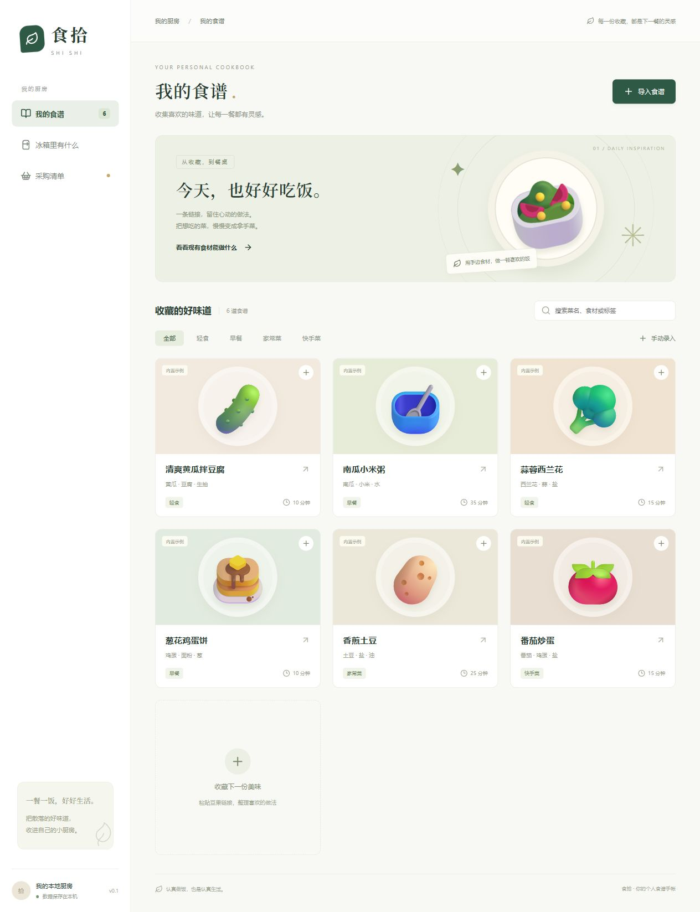
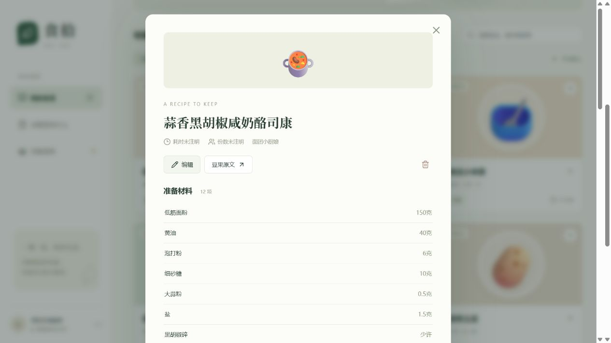
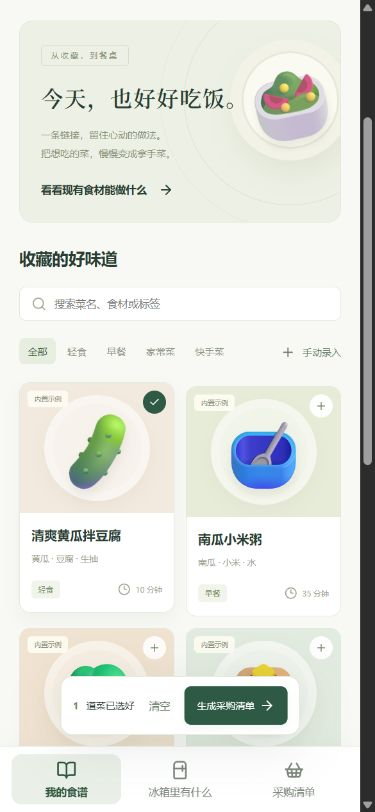
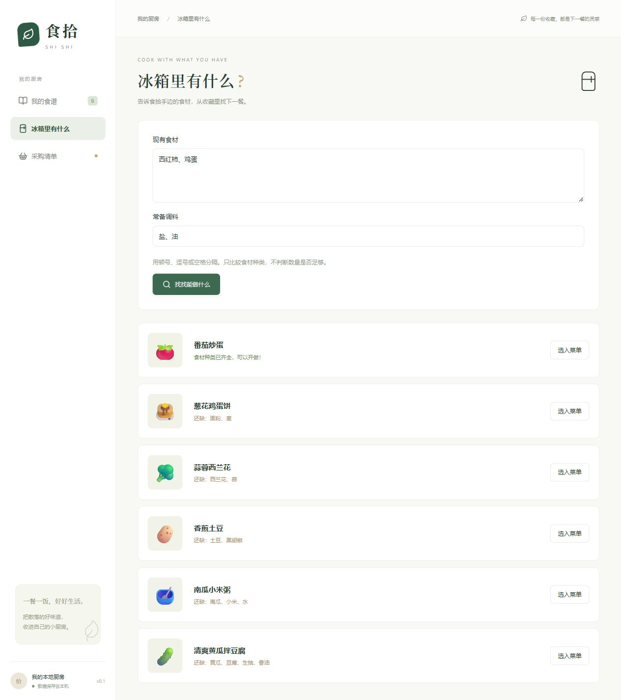
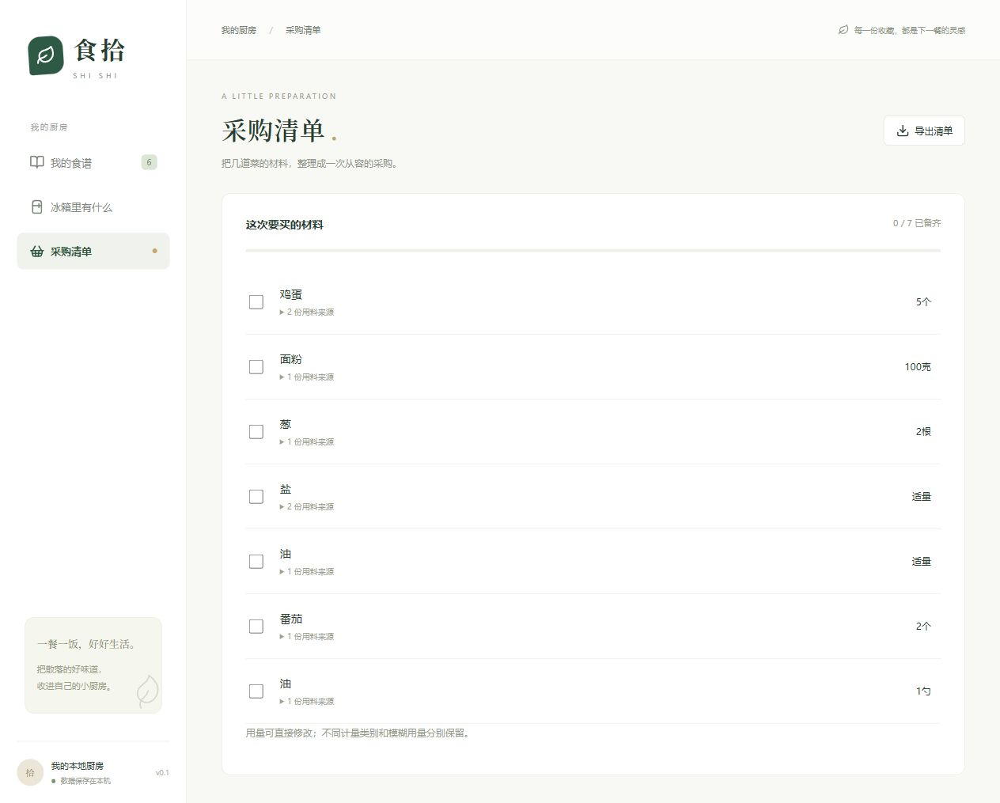
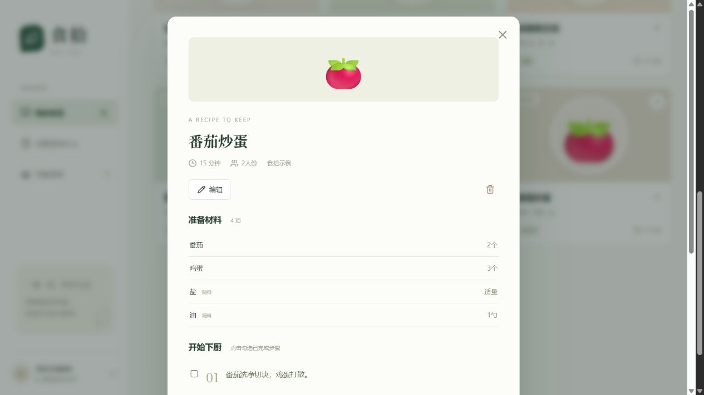
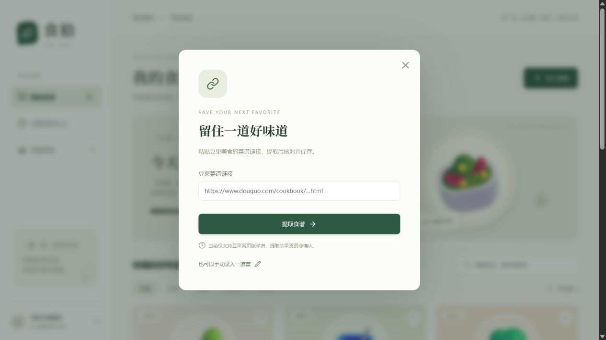
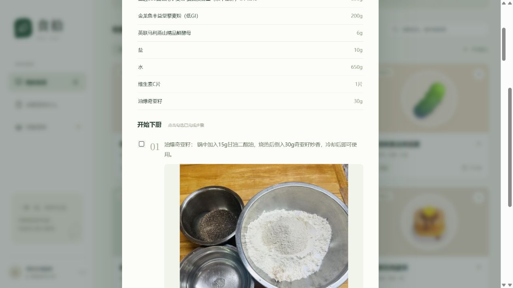
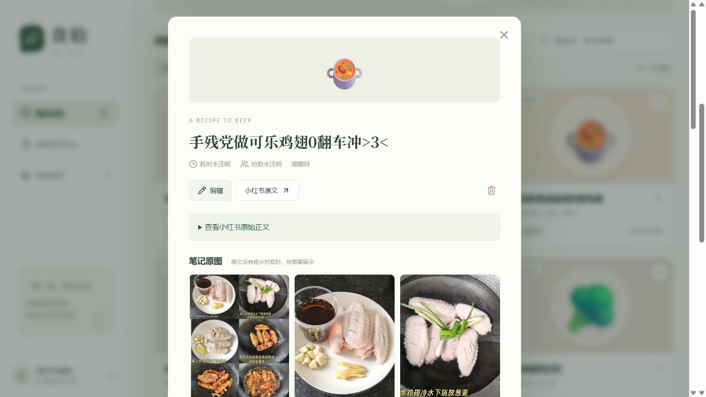
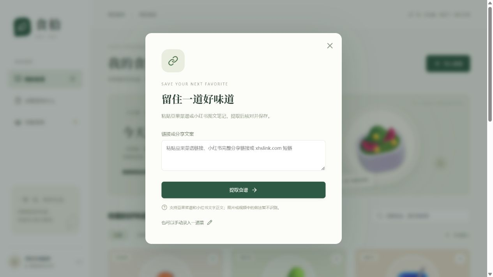

<div align="center">

# 食拾 · ShiShi

**把散落的好味道，收进自己的小厨房。**

本地运行的个人食谱管理 Web 应用：收藏做法、整理食材、挑选下一餐，再合并成一份采购清单。

Vue 3 · FastAPI · SQLite · 本地单用户版

[项目预览](#项目预览) · [快速开始](#快速开始) · [开发与测试](#开发与测试)

</div>



## 项目介绍

收藏了很多食谱，做饭时却还要逐个打开网页、寻找用料，再手动汇总采购材料。食拾将这些操作集中到一个小厨房里：把做法保存为统一格式，用已有食材找菜，并将几道菜的用料整理成采购清单。

当前为本地初版。链接导入适配 **豆果美食网页版菜谱**和 **小红书图文笔记正文**，也可以手动录入食谱；未接入大模型。首次启动内置六道演示食谱，方便体验完整流程。

## 功能一览

| 功能 | 当前支持 |
| --- | --- |
| 豆果链接导入 | 提取菜名、作者、食材与步骤，核对编辑后保存，提示重复链接 |
| 小红书图文导入 | 支持长链接、分享短链和分享文案，保留原文核对，缺少材料或步骤时提示补充 |
| 个人食谱库 | 按菜名、食材或标签搜索，按分类筛选，编辑和删除记录 |
| 下厨详情 | 查看用料、份数、耗时和备注，勾选已完成步骤 |
| 原图与步骤配图 | 豆果配图跟随步骤，小红书按原始图集展示；图片下载到本地 |
| 按食材找菜 | 输入现有食材和常备调料，按缺料种类排序并列出缺失材料 |
| 合并采购清单 | 多选食谱、合并兼容用量、查看来源、修改数量和勾选备齐 |
| 清单导出 | 导出为文本文件 |
| 本地保存 | 食谱、清单与食材设置持久化到 SQLite |

## 项目预览

以下为本地运行的实际页面截图；食谱库与匹配示例使用内置演示食谱，真实豆果导入结果见下图。

### 真实豆果链接导入

2026-11-03 已跑通“链接 → 网页提取 → 预览核对 → 保存 → 刷新读取”。示例为 [蒜香黑胡椒咸奶酪司康](https://www.douguo.com/cookbook/3359247.html)，核对时移除一行原文分组标题后，保存 12 项材料、14 个步骤。重复导入同一链接会提示已收藏。



### 手机端底部导航

屏幕宽度不超过 768px 时，导航固定在底部，提供“我的食谱”“冰箱里有什么”和“采购清单”三个入口；选菜操作条显示在底栏上方，并预留手机底部安全区。桌面保留侧栏布局。



### 按现有食材找菜

输入“西红柿、鸡蛋”，设置常备盐和油，系统将“西红柿”归一为“番茄”，优先显示材料种类齐全的食谱，同时列出其他菜还缺的材料。



### 多道菜合并采购清单

番茄炒蛋需要 3 个鸡蛋，葱花鸡蛋饼需要 2 个，合并后得到 5 个；油的“适量”和“1 勺”分别保留。每项材料都能回查来自哪道食谱。



<details>
<summary><strong>查看食谱详情与豆果导入窗口</strong></summary>

**食谱详情**：统一展示材料、用量、步骤和个人笔记。



**豆果导入**：粘贴菜谱链接，提取结果经核对后保存，也可以切换为手动录入。



</details>

## 快速开始

### 环境要求

- Python 3.11 或更高版本
- Node.js 20.19 或更高版本，包含 npm
- Windows PowerShell（使用仓库内的一键启动脚本）

首次安装依赖需要联网。保存后的食谱浏览、食材匹配与采购清单操作使用本地数据。

### Windows 一键启动

```powershell
git clone https://github.com/MieSheeeep/ShiShi.git
cd ShiShi
powershell -ExecutionPolicy Bypass -File .\start.ps1
```

脚本会创建 `.venv` 虚拟环境、安装 Python 和前端依赖、构建前端，然后启动服务。已有仓库可直接在项目根目录执行启动脚本。

打开 **[http://127.0.0.1:8000](http://127.0.0.1:8000)** 即可使用；终端按 `Ctrl+C` 停止服务。接口文档位于 [http://127.0.0.1:8000/docs](http://127.0.0.1:8000/docs)。

### 后续直接启动

依赖已安装、前端已构建且没有更新时，可以跳过安装步骤：

```powershell
.\.venv\Scripts\python.exe -m uvicorn backend.main:app --host 127.0.0.1 --port 8000
```

## 使用流程

1. **收藏食谱**：点击“导入食谱”，粘贴豆果菜谱、小红书完整分享链接或分享文案；也可选择“手动录入”。
2. **核对保存**：检查菜名、用料和步骤，补充标签、耗时和个人备注后保存。
3. **挑选下一餐**：搜索自己的食谱，或在“冰箱里有什么”里输入已有食材和常备调料。
4. **合并采购**：点击食谱卡片上的“＋”，选好几道菜后生成采购清单。
5. **备料下厨**：修改或勾选采购项，在详情中逐步勾选已完成的操作。

生成采购清单会替换当前清单，需要保留上次记录时可先导出文本。下厨步骤勾选仅保留在本次页面会话中。

## 数据处理规则

| 场景 | 处理方式 |
| --- | --- |
| 食材别名 | 西红柿 → 番茄；马铃薯、洋芋 → 土豆；食盐 → 盐 |
| 兼容单位 | 500 克 + 0.5 千克 = 1000 克，毫升与升同样换算 |
| 不同计量类别 | 鸡蛋 2 个与鸡蛋 100 克分开保留，不猜测单个重量 |
| 模糊或范围用量 | “适量”“少许”“100—150 毫升”等保留文字，不强行求和 |
| 中文数量 | 支持“两个”“半个”等常见单字表达，暂不覆盖全部中文数字写法 |
| 食材匹配 | 比较材料种类，扣除已有材料和常备调料，不判断库存数量是否足够 |

数量计算使用 `Decimal`，规则和别名表位于 [backend/core.py](backend/core.py)。

### 步骤配图

已用真实豆果菜谱验证：导入“奇亚籽轻法棍”保存了 10 个步骤与 10 张配图。图片保存在本机，查看详情时无需重新请求原图网站；小红书没有逐步对应关系的图片按图集展示，暂不识别图片内的文字。



下载限制、备份与验证结果见 [图片说明](docs/images.md)。

## 豆果导入范围与当前限制

- 只接受 `https://www.douguo.com/cookbook/数字.html` 格式的网页版菜谱链接，保存前移除查询参数。
- 优先读取 Recipe JSON-LD，再读取豆果材料表与步骤节点。
- 单次只抓取一个页面，单次网络操作超时设置为 20 秒，连接失败最多重试一次，响应大小上限 3 MB，拒绝重定向。
- 页面不存在、返回验证页或缺少材料和步骤时显示失败原因，不保存不完整食谱。
- 原文未注明的信息保持为空或“未注明”，不生成新的做法。

**在线采集已完成一次完整页面验收，网络稳定性仍有限**：当前环境间歇出现 TLS 握手失败，增加了一次有限重试及明确错误提示，未关闭证书校验。网站改版、验证页和访问限制仍可能导致失败，不能保证所有豆果菜谱都可导入。原文中的材料分组标题等内容可能需要在预览中手动整理。

当前版本面向单用户本机使用，未实现登录、多用户隔离、批量抓取、图片识别、视频解析或长期饮食计划。

## 小红书接入

复用 [ReaJason/xhs](https://github.com/ReaJason/xhs) 的 MIT 授权网页状态提取代码，固定提交 `f4b62d9f8e4078e631fc6e4ec8e430bc711ee9f0`；具体改编范围见 [第三方声明](THIRD_PARTY_NOTICES.md) 与 [MIT 许可证](third_party/xhs-LICENSE)。没有引入整个 SDK 或签名服务。

- 接受 `xiaohongshu.com/explore/笔记编号`、`/discovery/item/笔记编号` 和 `xhslink.com` 分享短链。
- 用标题、作者和正文生成可编辑草稿；只对明确的食材与做法段落拆分，保留原文，不补写缺失内容。
- 按笔记编号去重；抓取时保留分享参数，保存来源时去掉临时访问参数。
- 只解析正文文字，不识别图片或视频。做法在图片里的笔记需要用户对照补充。
- 需要登录时，可在本机通过 `XHS_COOKIE` 环境变量提供自己的登录态；Cookie 不写入数据库，不发送给短链域名，不自动从浏览器读取。
- 遇到登录、验证码或访问限制会停止并提示，不自动处理验证码。

**真实验证已通过**：2026-11-03 使用用户提供的完整分享链接导入“手残党做可乐鸡翅0翻车冲>3<”（作者：璐璐呀），得到 8 项材料、6 个步骤、8 张原图，保存后重新读取一致，重复导入返回 409。本次没有配置 Cookie。原文未注明鸡翅数量，保留为“未注明”。此前搜索得到的另一些链接仍被平台限制访问，不能保证所有笔记可采集。

支持该样本中的装饰性标题、竖线分隔材料、圆圈步骤编号，并将 Tips 与话题区排除在步骤之外。图片仍按原图集展示，不自动猜测步骤对应。



使用与本机登录态配置见 [小红书接入说明](docs/xiaohongshu.md)。



## 技术与目录

| 部分 | 技术 |
| --- | --- |
| 前端 | Vue 3、Vite、Lucide 图标 |
| API | Python、FastAPI、Pydantic、Uvicorn |
| 网页解析 | HTTPX、BeautifulSoup |
| 存储 | SQLAlchemy、SQLite |
| 测试 | pytest、FastAPI TestClient |

```text
ShiShi/
├── backend/
│   ├── core.py          # 豆果解析、别名、用量与合并规则
│   ├── crawler.py       # 网络抓取、有限重试和失败原因
│   ├── source_urls.py   # 来源验证与链接归一
│   ├── xiaohongshu.py   # 短链、图文正文与食谱草稿
│   ├── media.py         # 步骤原图下载、校验与本地保存
│   ├── vendor/          # 带版权声明的上游提取代码
│   ├── main.py          # 接口与 SQLite 持久化
│   └── seed.py          # 内置演示食谱
├── frontend/src/        # Vue 页面与样式
├── tests/               # 解析、规则及接口测试
├── docs/
│   ├── screenshots/     # README 项目截图
│   ├── design.md        # 本地初版设计
│   ├── plan.md          # 实施计划
│   └── verification.md  # 验证记录
├── data/                # 运行时生成，不提交到 Git
├── requirements.txt
└── start.ps1            # Windows 安装、构建与启动
```

## 开发与测试

先运行一键启动脚本完成依赖安装，再停止服务，在两个终端分别启动开发服务。

**后端（项目根目录）：**

```powershell
.\.venv\Scripts\python.exe -m uvicorn backend.main:app --reload --host 127.0.0.1 --port 8000
```

**前端：**

```powershell
cd frontend
npm run dev
```

访问终端显示的 Vite 地址，开发服务器将 `/api` 请求代理到本地后端。

**测试与生产构建：**

```powershell
# 项目根目录
.\.venv\Scripts\python.exe -m pytest tests -q -p no:cacheprovider

cd frontend
npm run build
```

现有 39 项测试覆盖豆果与小红书正文解析、链接校验、短链与 Cookie 域隔离、装饰标题与材料分隔、步骤图对应、图集与本地图片保存、数量合并、别名匹配、连接重试上限、HTTP 错误、页面大小限制、食谱和清单接口，详见 [验证记录](docs/verification.md)。

## 本地数据与备份

默认数据库为 `data/shishi.db`，首次运行自动创建。停止服务后，同时复制数据库和 `data/media/` 图片目录即可备份；恢复时先停止服务，再恢复这两部分。

数据库、虚拟环境、前端依赖和构建产物均已加入 `.gitignore`。服务默认仅监听 `127.0.0.1`。
