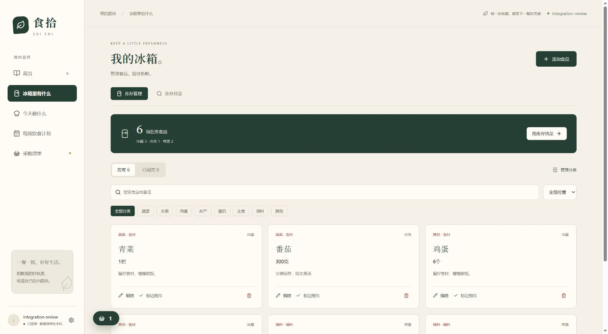
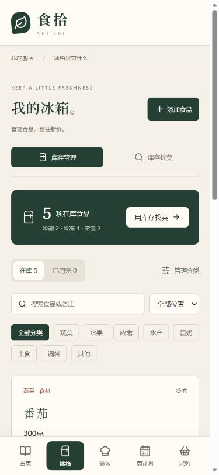

# 冰箱库存管理与兼容升级

## 使用方式

“冰箱里有什么”分为库存管理与库存找菜两个视图。库存按每页六项展示，可按名称或备注、食品分类、冷藏/冷冻/常温、在库/已用完筛选。

食品手动录入，支持名称、数量、单位、食材/调料用途、食品分类、存放位置和备注。数量可留空或保留“半”等文字，不推测数值。名称提供已有食谱材料的输入建议；新增食品命中现有调料规则时默认选为调料，用户可以修改。

同名食品可分条保存。用完后移入历史，恢复时保留原数量、单位、分类、位置和备注；删除前需确认。分类可创建、改名和删除，仍被食品（含用完记录）使用的分类不能删除，至少保留一个分类。

库存找菜只使用在库食材和调料，按缺料种类排序，保留 AI 推荐入口。AI 配置沿用当前账号的设置；本次浏览器验收不发送外部模型请求。



手机底栏为首页、冰箱、做饭、周计划、采购五项单排，按钮保留完整无障碍名称。录入弹窗短字段并排，可滚动、支持 Escape 关闭和焦点回到入口。



## 接口

全部接口需要 Bearer 令牌，按账号隔离，跨账号访问记录返回 404。

| 方法 | 路径 | 说明 |
| --- | --- | --- |
| GET | `/api/fridge` | 读取库存，首次访问执行兼容迁入 |
| POST | `/api/fridge/items` | 新增食品，返回含稳定 ID 的食品 |
| PUT | `/api/fridge/items/{id}` | 完整更新食品，包含用完或恢复 |
| DELETE | `/api/fridge/items/{id}` | 删除食品 |
| POST | `/api/fridge/categories` | 新增分类，返回 `{id,name}` |
| PATCH | `/api/fridge/categories/{id}` | 重命名分类 |
| DELETE | `/api/fridge/categories/{id}` | 删除未使用的分类 |

读取结构为 `{schema_version:2,categories:[{id,name}],items:[...]}`。食品示例：

```json
{
  "id": "稳定ID",
  "name": "番茄",
  "amount": "300",
  "unit": "克",
  "kind": "食材",
  "category_id": "分类ID",
  "location": "冷藏",
  "status": "active",
  "notes": "分装保存"
}
```

食品 ID 由服务器生成或从更新路径指定。名称最多 100 字符、不能为空白，数量最多 100 字符、单位最多 10 字符、备注最多 1000 字符。kind 为食材/调料，location 为冷藏/冷冻/常温，status 为 active/used。每账号最多保留 1000 条食品、60 个分类。重名分类返回 409；无效分类、非法字段、删除非空分类或最后一个分类返回 422。

## 与现有功能共用数据

- 完整库存保存在 SQLite `settings` 的 `<账号ID>:fridge` 文档，是升级后库存的唯一工作数据。
- 未打开新版库存时继续使用原 `<账号ID>:pantry`。首次访问 `/api/fridge`，将旧食材与调料（字符串或 name/amount/unit 对象）迁入，保留数量和单位、生成稳定 ID，以后不重复迁入。
- 已运行旧增强分支的 schema 1 库存，保留 ID、分类、状态、位置、备注，将自由文字 quantity 保留到 amount；未填数量的同名在库食品可补入旧 pantry 数量，缺少条目补入。已用完食品不因迁移重新入库。
- 迁移不删除旧 pantry 原文；schema 1 原文另存 `<账号ID>:fridge-pre-v2`。转换与修改在 SQLite `BEGIN IMMEDIATE` 事务内执行，失败回滚。
- 新版存在后，`GET /api/settings` 返回同一库存的在库投影，仍是 name/amount/unit。旧客户端 `PUT /api/settings` 更新在库条目，同名同用途按顺序复用 ID 和元数据，保留已用完历史；从提交的完整列表省略在库条目表示删除。
- 采购扣减、每周计划继续通过 `read_settings` 使用同一在库数据。用完食品不参与，恢复后重新参与。AI 推荐与找菜页面使用相同投影。
- 找菜只比较种类，采购保留 main 原规则：无法换算单位或未写数量的库存仍按已有处理，需用户核对，可在采购页手动改为采购。不猜测模糊用量，不在做饭后自动扣库存。

## 备份与回退

升级前停止服务，同时备份数据库和媒体目录；运行中的数据库可用 SQLite 在线备份。没有新增表，库存随整库备份保存；验收使用独立临时数据库，不覆盖正式库。

旧 pantry 原文只用于迁移审计与回退参考，不随新版食品编辑更新，不等于最新备份。回退前先备份升级后数据，再恢复升级前备份及对应版本程序，防止丢失后续修改。
