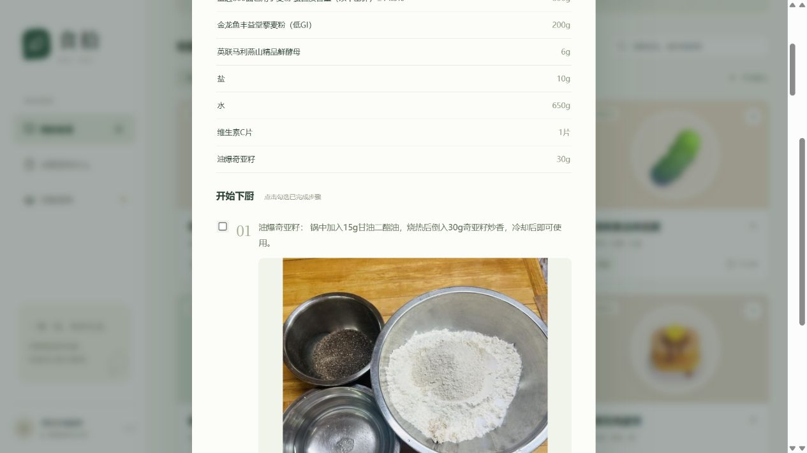

# 食谱原图与步骤配图

## 当前行为

- 豆果：按每个 `.stepcont` 读取原始配图地址，图片与原步骤一一对应。预览编辑和食谱详情都可查看图片；点击打开本地原图。
- 小红书：提取笔记 `imageList` 中的原图地址，按原图集顺序展示。没有逐步对应关系时不猜测配图属于哪一步。
- 图片以原始字节保存到 `data/media/`，文件名使用内容 SHA-256，重复图片复用同名文件。接口 `/api/media/文件名` 从本地读取，不在浏览食谱时重新访问原站。
- V2 将图片保存在每个步骤的 `images` 内；移动步骤时文字与图片一起移动。可以重新关联现有原图、调整步骤内图片和图集的顺序，移除引用后仍可从原图补回。删除步骤不删除来源原图或初始快照。旧版数据自动备份迁移，详见 [保存格式](recipe-format.md)。
- 只下载固定平台图片域名，不自动跟随图片跳转，不发送小红书 Cookie。每张上限 5 MB，每次最多处理 24 张、总保存上限 30 MB，限制解码像素数并验证实际图片格式。
- 图片失败时显示警告，仍允许核对保存文字。图片只做采集和展示，不做 OCR，也不自动还原图片中写出的食材与做法。
- 删食谱后暂不自动清理媒体文件，避免共享图片被误删。备份时同时复制 `data/shishi.db` 与 `data/media/`。

首页精选另外使用随程序发布的 `frontend/public/editorial/` 图片，生成来源明确标注，收藏后保留静态资源引用。这些资源随前端构建发布，需与程序一并保留；采集图片的保存与备份方式保持不变。见 [精选说明](daily-content.md)。

## 真实验收 · 2026-11-03

[奇亚籽轻法棍](https://www.douguo.com/cookbook/3359224.html)：7 项材料、10 个步骤、10 张图片。通过导入接口下载原图、保存到本地数据库，再从列表重新读取；本地图片请求返回 HTTP 200，浏览器查看步骤配图正常。

小红书也已通过一条真实图文笔记验收：笔记 `6a059edd000000000702dff1` 的 8 张原图全部保存到本地，并在食谱详情按原顺序显示。该笔记由用户提供完整分享链接；其他过期或访问受限链接仍可能失败。
