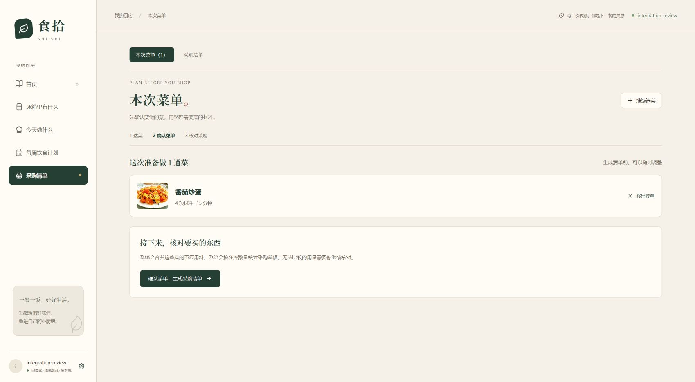
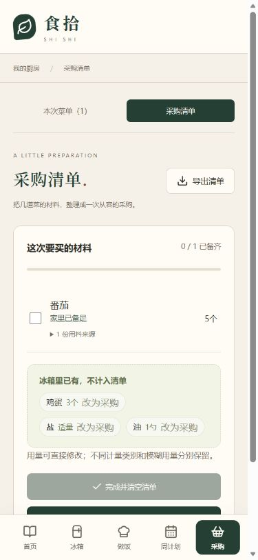

# 菜单确认与采购核对

流程为：在食谱库或库存匹配结果选菜 → 确认本次菜单 → 生成并核对采购清单。

- 菜单按选择顺序展示，可移除、继续选菜或进入详情；删除过的食谱不保留在恢复后的选择中。
- 底部入口改为“确认菜单”，采购页提供“本次菜单 / 采购清单”切换。
- 存在旧清单时，重新生成先提示覆盖手动用量和购买进度，确认后调用原 `POST /api/shopping`。
- 菜单草稿按账号保存在浏览器 `shishi-menu:<账号ID>`，刷新或重新登录后恢复，不跨设备同步。存储不可用时仍可临时选菜。
- “今天做什么”的下厨菜单与采购选择分开，不改变 main 已有的逐步做饭功能。

## 清单兼容与用户核对

数量合并、换算和库存扣减沿用 main。已有材料用 `pantry:true` 标识，不足时列计算差额；无法比较单位或未注明库存数量时按已有处理，需用户核对：

- 待买项可标记“家里已备足”，已有项可“改为采购”，只修改本次清单，不改变库存。
- 改变采购归属会清除该项已买勾选，保留用量和来源。
- 修改用量后离开输入框保存；Enter 移开焦点并保存，同时清除该项购买勾选，按新用量重新核对。
- 保存中禁用清单的勾选、归属和用量输入；失败显示错误，未保存成功的内容应重试，刷新以后端记录为准。
- 导出仅含待买部分，全为家里已有也允许确认完成并清空。
- 旧增强分支的 `at_home` 在读取且缺少 `pantry` 时转换成同义 pantry，新交互统一写 pantry。

采购清单保存在 SQLite，菜单草稿保存在浏览器。二者都不是每周计划，生成或清空采购不会改写计划。
