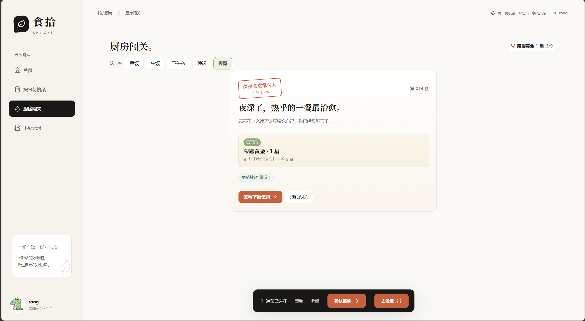
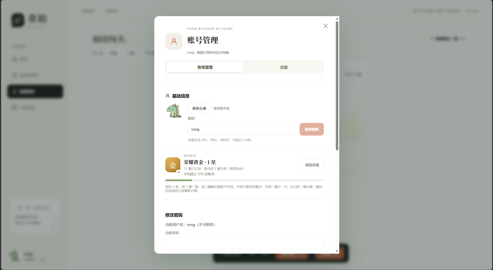
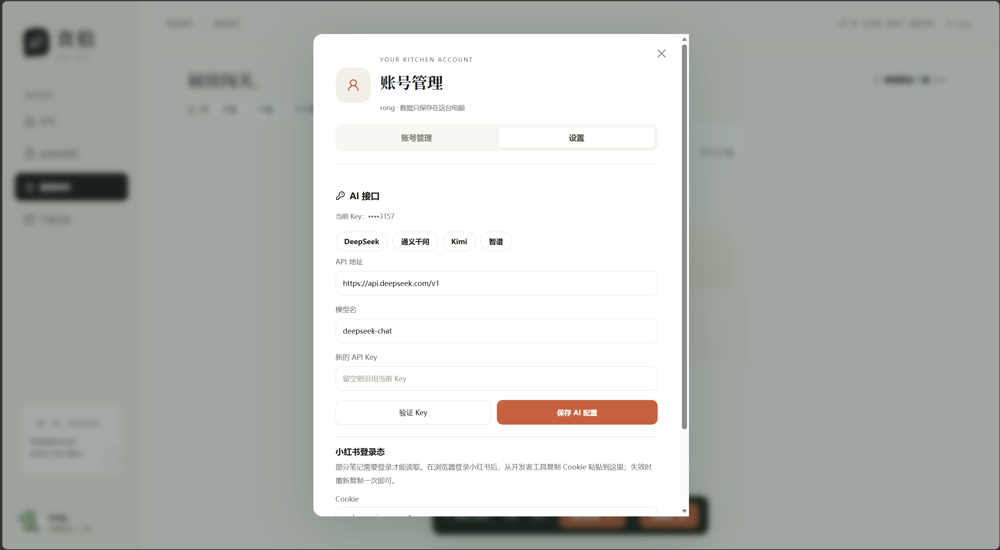
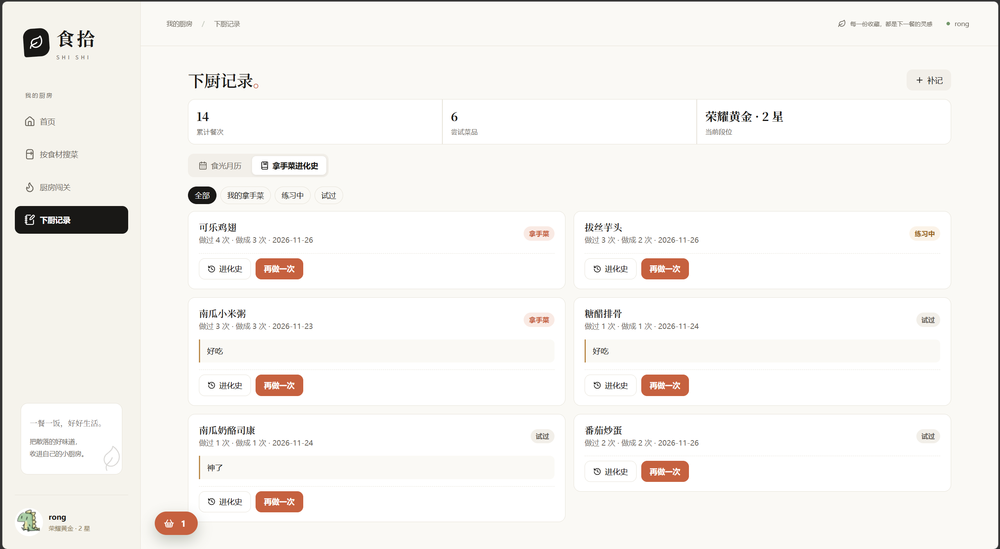
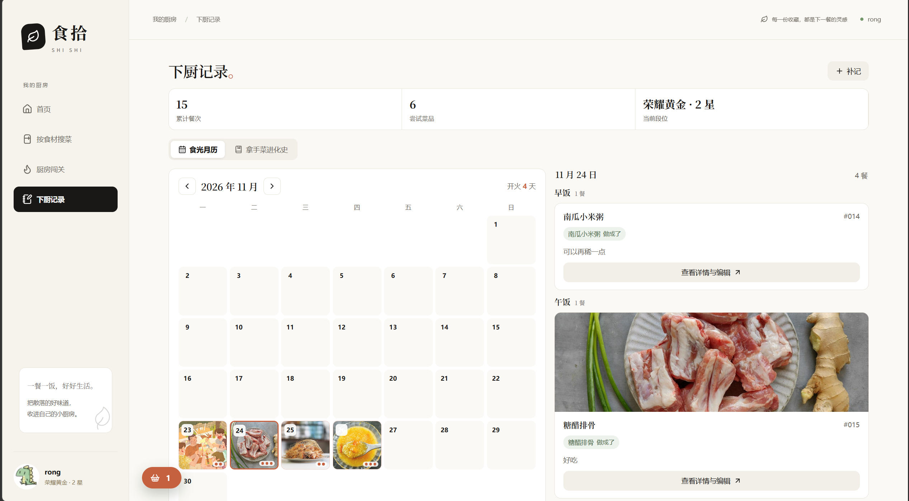
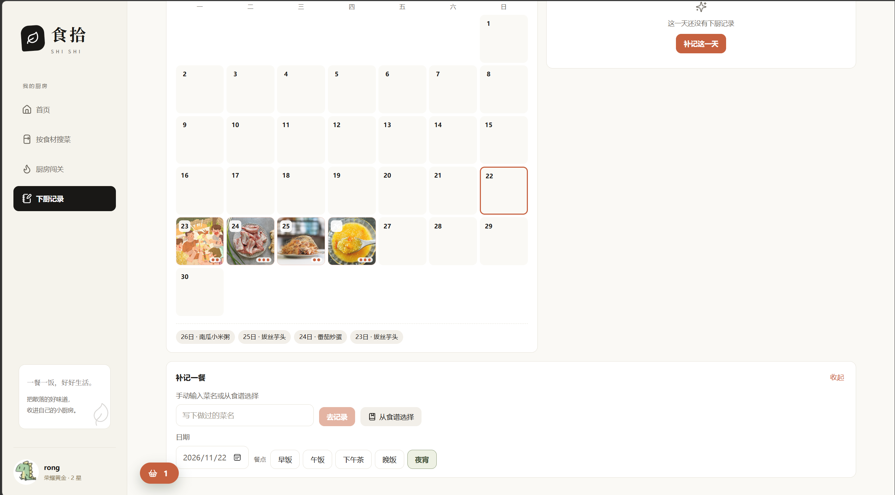

# 下厨成长与账号面板改造 · 交付报告

- 日期：2026-11-26
- 分支：`codex/profile-avatar`（工作区未提交）
- 运行方式：前端 Vite 开发服务器 `127.0.0.1:5173`，代理到后端 `127.0.0.1:8001`（项目 `.venv`）
- 数据：本机 `data/shishi.db`，当前账号（rong）已完成 **15 餐**、**6 道菜**，段位「荣耀黄金 · 2 星」

## 一、交付内容

### 1. 头像与账号入口

| 项 | 实现 |
| --- | --- |
| 左下角入口 | 头像按钮（48px，无头像时显示用户名首字），点击打开账号面板 |
| 齿轮入口 | 已移除，账号管理统一走头像 |
| 头像上传 | 复用 `/api/media`，地址存入 `settings` 表（key `<uid>:avatar`），注销时随账号清理 |
| 昵称 | 新增 `GET/PUT /api/profile/nickname`；留空恢复用户名；用户名不可改 |
| 面板结构 | 两个 tab：账号管理（基础信息 / 我的段位 / 修改密码 / 登录状态 / 注销）、设置（AI 接口 / 小红书 Cookie） |

### 2. 段位体系（八档，七档 + 无上限巅峰）

| 段 | 称号 | 起步餐次 | 字牌 |
| --- | --- | --- | --- |
| 1 | 倔强青铜 | 0 | 青 |
| 2 | 秩序白银 | 6 | 银 |
| 3 | 荣耀黄金 | 12 | 金 |
| 4 | 尊贵铂金 | 18 | 铂 |
| 5 | 永恒钻石 | 24 | 钻 |
| 6 | 至尊星耀 | 30 | 耀 |
| 7 | 最强王者 | 36 | 王 |
| 8 | 巅峰 | 48 | 峰 |

- 每档 3 星、每 2 餐一星；进入巅峰后星数不封顶（48 餐=1 星，480 餐=217 星）。
- 字牌为原创渐变方块 + 单字，不使用任何官方图标。
- 账号面板展示当前段位、星级、距下一档进度、段位总览（全部八档与升级规则）。
- 「本机超过 X% 的账号」按本机 SQLite 账号的真实餐次排名计算；只有一个账号时显示暂无可比较。

### 3. 完成瞬间的即时反馈

- 收尾成功后，完成页立即显示：当前段位与星级、本餐加了几星（未加星显示「已记录」）、距离下一段还差几餐。
- 跨档时显示「段位晋升」金色卡片，并播放一次放大回弹动效；系统开启减少动效时自动降级为静态。
- 撤回或开始新一餐时清空反馈，避免串到下一餐。

### 4. 下厨记录与厨房闯关

| 项 | 实现 |
| --- | --- |
| 补记选食谱 | 补记抽屉新增「从食谱中选择」，带搜索（菜名/食材）、封面与材料预览；选中后直接进入该餐记录 |
| 餐点 | 新增 `meal_slot`（早饭/午饭/下午茶/晚饭/夜宵），按当前时间预选；记录按餐点分组，只显示有记录的分区 |
| 补记布局 | 抽屉移到页面底部，点击后平滑滚动到抽屉；菜名输入框限宽 260px，与「去记录」「从食谱选择」同行 |
| 放弃 | 做菜页「放弃」与「出锅」并排，二次确认后撤回记录、不计入成长 |
| 选菜浮条 | 去掉「仅在食谱页/食材页显示」的限制，任意页面选中菜品后都显示 |
| 拿手菜状态 | 改为按记录自动判定：做成 ≥3 次为拿手菜，有失败未满 3 次为练习中，其余为试过；手动标记不再影响展示 |

## 二、接口与数据变更

| 类型 | 内容 |
| --- | --- |
| 新增接口 | `GET/PUT /api/profile/avatar`、`GET/PUT /api/profile/nickname`（鉴权后可用） |
| 字段扩展 | `cooking-sessions` 新增可选 `meal_slot`（仅存 body JSON，无表结构变更、无迁移，旧记录视为未标注） |
| 摘要扩展 | `/api/cooking-summary` 的 `level` 增加 `tier`、`star`；新增 `percentile`（percent / accounts / ahead） |
| 语义变更 | `repertoire[].status` 改为派生字段（自动判定）；`PUT /api/cooking-dishes` 保留但不再影响展示与成就 |

> 数据格式有变更：新前端需配新后端（旧后端会因字段校验返回 422）。按协作约定需在群里知会接口与数据格式调整——**截至本报告生成时尚未知会**。
>
> 字段级约定见 [api.md](../api.md)（头像、昵称）与 [cooking-records.md](../cooking-records.md)（`meal_slot`、摘要的 `level`/`percentile`），本报告只记录变更摘要，不复写字段定义。

## 三、验证结果（均为实际执行）

| 检查 | 结果 |
| --- | --- |
| `pytest tests` | 160 passed |
| `node --test tests/` | 41 passed |
| Vite 编译改动模块（App / AccountPanel / CookingWorkspace / KitchenFootprints / cookingLevels / cookingJournal / css） | 全部 200，响应体无报错关键字 |
| 后端健康检查 | `127.0.0.1:8001/api/health` 200；`5173/api/health` 代理 200 |
| 真实数据核算 | 15 餐 → 荣耀黄金 2 星，距铂金 3 餐；本机 2 个账号，超过 50% |
| 界面截图 | 见下方证据，6 张均为本次运行截图 |

## 四、截图证据

### 1. 完成页即时反馈

第 013 餐完成后显示「已记录 / 荣耀黄金 · 1 星 / 距离『尊贵铂金』还差 5 餐」；右上是当前段位角标。

### 2. 账号面板 · 基础信息与段位卡

头像与昵称、用户名展示在修改密码上方；段位卡为渐变字牌「金」+ 星级 + 本机百分比 + 段位总览入口。

### 3. 账号面板 · 设置页

AI 接口（服务商快捷选择、地址、模型、Key）与小红书 Cookie 已集中到此页。

### 4. 拿手菜进化史

可乐鸡翅、南瓜小米粥显示「拿手菜」，拔丝芋头「练习中」，糖醋排骨等「试过」；状态为自动判定结果。底部可见跨页显示的选菜浮条。

### 5. 食光月历

按日期查看记录，右侧按早饭/午饭等餐点分区展示。

### 6. 补记抽屉

补记位于页面底部，包含「手动输入菜名或从食谱选择」、日期与餐点 chip（图中选中夜宵）。

## 五、已知限制与风险

1. **段位表双源**：前端 `cookingLevels.js` 与后端 `TIERS` 必须手工同步，改档位名称或门槛容易漏改。建议后续由后端下发档位表。
2. **百分位样本极小**：只比较本机账号，两个账号时结果只有 0/50/100 三档；界面已不写「全服排名」，文档保留口径说明。
3. **手动标记残留**：`cooking_dishes` 里旧标记不再生效但数据仍在，若将来重新启用覆盖逻辑会复活。
4. **旧进程**：`127.0.0.1:8000` 仍有 22:34 启动的旧后端占用，运行的是改动前逻辑；当前验证全部走 8001。
5. **未做视觉回归**：截图覆盖桌面宽度；移动端（≤650px）的浮条、抽屉、字牌宽度未实测。
6. **分段提交**：本次改动横跨头像、补记、段位、反馈等多条功能线，均在同一个工作区，提交前需按 PR 规范拆分为独立分支/提交。
7. **未跟踪文件**：`.ppt_edit/`、`png/`、`probe_css.py` 与本任务无关，提交时勿加入。
